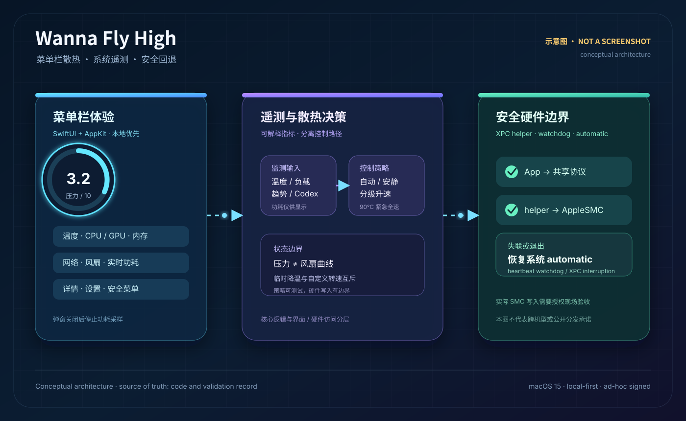
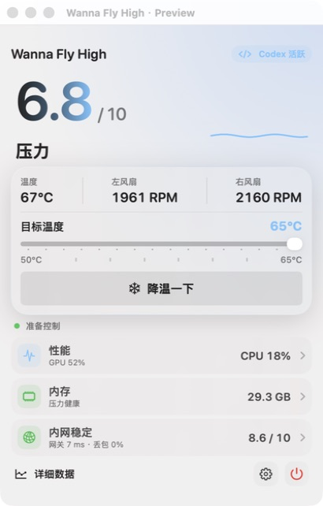

# Wanna Fly High

> 中文优先的 macOS 菜单栏散热与系统遥测项目。
>
> English overview: Wanna Fly High is a native macOS menu bar utility for local fan control and system telemetry. It separates display telemetry, cooling policy, and privileged hardware access, with watchdog-based fallback to automatic fan control.

本仓库提供项目案例、架构与验证说明。应用源码和本机安装包保留为私有。

上图为原创示意图，不是实际运行截图。

## 项目是什么

Wanna Fly High 面向需要持续运行本地计算任务的 macOS 用户。它在菜单栏展示压力、温度、负载、内存、网络和按需读取的整机功耗，并把散热策略、AppleSMC 访问和特权 helper 分成独立层次。

它在系统自动控制、自动平衡、安静和临时降温之间提供可解释的选择，同时保留 90°C 紧急全速和异常恢复路径。

## 能力证据

| 能力 | 代码或记录中的证据 | 展示意义 |
| --- | --- | --- |
| 原生 macOS 产品工程 | Swift 6、macOS 15、SwiftUI/AppKit、`NSStatusItem`、瞬态 popover、设置与详情页 | 能把系统级能力整理成可用的菜单栏产品 |
| 硬件与系统集成 | `WannaFlyHighSMC` 使用 IOKit；独立 `WannaFlyHighHelper` 通过 XPC 处理风扇写入 | 能处理权限边界、协议和硬件失败路径 |
| 控制策略设计 | 目标温度、压力指标、持续负载、升温趋势、Codex 活跃预升速、RPM 上下限 | 能把热管理规则拆成可测试的纯逻辑 |
| 安全回退 | heartbeat watchdog、连接中断恢复、退出/睡眠恢复系统 automatic、互斥的临时控制意图 | 把异常状态当作产品行为设计，而非事后补丁 |
| 遥测与可观察性 | CPU、GPU、内存、网络、热点温度、风扇、压力历史和按需功耗采样 | 让控制行为能被解释和核对 |
| 可测试核心 | 当前测试文件包含 27 个 Swift Testing 用例，覆盖压力、曲线、RPM 限制、功耗输入和升降速策略 | 为硬件写入前的关键决策提供回归保护 |

## 关键设计决定

1. 功耗只服务于菜单弹窗显示。弹窗打开时立即采样，之后按约 2 秒更新；弹窗关闭即停止，功耗不会进入压力分、风扇曲线或 helper 协议。
2. 压力分与用户目标温度、风扇曲线解耦。温度、持续 CPU/GPU 负载和升温趋势分别贡献分数，温度尖峰使用中位数过滤。
3. 普通高负载采用分级升速，并以系统当前实际转速作为首次接管基线；90°C 紧急保护和用户主动全速可以绕过普通升速节流。
4. App 只通过共享协议请求 helper 操作 SMC。helper 校验连接用户和调用程序，并在 heartbeat 超时、连接中断或进程退出时尝试恢复系统自动控制。
5. 外部点击监听只在 popover 显示期间启用；交互修复不会进入功耗、压力、风扇曲线、helper 或 SMC 写入路径。

## 架构与视觉说明

详细组件关系与数据流见 [架构说明](docs/architecture.md)。

### 界面迭代预览

这是 2026-07-30 的静态界面设计预览，使用合成温度、转速和负载指标，用于说明信息层级与操作布局。它不是当前版本的真实硬件运行截图。

## 验证快照

- 2026-08-20 的历史记录显示，0.1.14 / build 15 完成版本与签名核对、单一主进程、helper `ping`、系统模式、外部点击收起、菜单/详情/设置返回、右键菜单和正常退出恢复的本机验收。
- 同一记录明确写出：当轮没有主动切换风扇控制、没有主动睡眠，也没有制造 heartbeat/XPC 断线。因此不能把这次结果表述为 0.1.14 的真实自动曲线、睡眠恢复和断线恢复已经现场触发通过。
- 2026-10-03 的文档审阅只读检查到本机安装 App 的版本为 0.1.14 / build 15，严格代码签名验证通过且为 ad-hoc 签名；本次没有重新构建、安装或运行完整测试。
- 完整的历史来源、测试日期和未验证范围见 [验证记录](docs/validation.md)。

## 边界与适用范围

- 最低系统为 macOS 15；AppleSMC 与风扇控制路径面向本机硬件环境，不能据此承诺跨机型兼容。
- 当前安装包是本机 ad-hoc 签名版本，未公证，不构成公开分发承诺。
- 真实 SMC 写入需要在目标设备上受控验收；不同工具同时控制风扇可能产生冲突。本展示不提供安装包或真实硬件控制入口。
- 开发过程中使用 AI 辅助；本人负责需求、中文界面方向、安全边界和迭代确认。
- 本案例描述本地项目；私有 GitHub 仓库中的应用源码仍是较早快照，公开展示仓库不提供可运行源码。

## 文档

- [架构说明](docs/architecture.md)
- [验证记录与边界](docs/validation.md)
