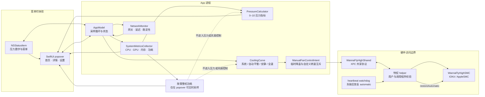
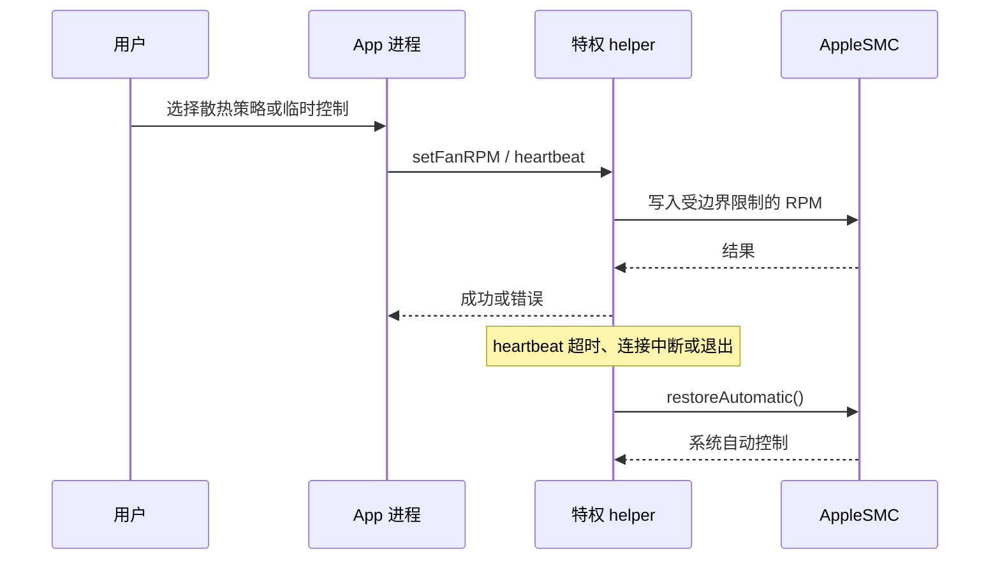

# 架构说明

这是一张面向作品集读者的逻辑架构图。它根据 2026-10-03 审阅到的本机源代码和项目记录整理，属于示意图，不是运行时调用追踪，也不替代源代码。

## 数据流的边界

### 遥测层

`SystemMetricsCollector` 和 `NetworkMonitor` 为界面提供 CPU、GPU、内存、网络、温度关联数据以及顶部进程等信息。整机功耗是独立的按需读取：弹窗显示时采样，关闭后清空并停止采样。

功耗显示路径不会进入压力计算、散热曲线或 helper 协议。这条边界是项目记录和测试反复强调的设计决定，避免把短时功耗峰值直接变成风扇写入指令。

### 决策层

压力指标由绝对温度区间、持续计算负载和升温趋势组成，目标温度不参与压力分。散热曲线另行使用当前温度、目标温度、负载、升温趋势和 Codex 活跃状态。

普通高负载使用分级升速；首次接管会观察当前风扇转速，避免先把系统已经拉高的转速压低。90°C 紧急路径、临时全速和最大模式保留更高优先级。

### 特权层

App 不直接把每一个 UI 状态写入 SMC，而是通过共享协议请求特权 helper。helper 会校验连接的用户和调用程序名称，维护 heartbeat，并在 XPC 连接中断、进程退出或 watchdog 超时后尝试调用 `restoreAutomatic`。

“控制失败时恢复系统”是控制协议的一部分。实际恢复是否成功仍需要在目标硬件上做受控验收。

## 交互层的局部设计

`NSStatusItem` 负责左键 popover 和右键安全菜单。0.1.14 为解决跨 App 点击后 popover 不可靠收起的问题，只在 popover 显示期间安装鼠标按下监听，关闭时立即移除，并使用监听代数避免旧事件误关新一轮 popover。

这项修复保持在界面层，没有改变功耗采样、压力算法、风扇曲线、helper/XPC 或 AppleSMC 写入路径。

## 关键恢复序列

图中的恢复调用表示设计路径；是否在睡眠、XPC 断开和 heartbeat 丢失时现场触发通过，见 [验证记录](validation.md)。
